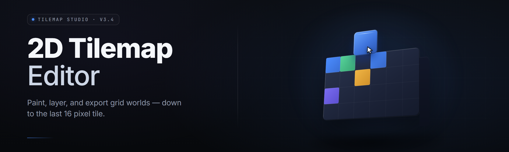

  
  
  

  

  
  

---

**Paint the map once. Ship it everywhere.** A desktop 2D tilemap editor for level designers who are tired of fighting their tools — tileset slicing, autotile brushes, layers, collision paint, and a clean export that drops straight into GameMaker, Godot, Unity, Phaser, and plain JSON.

*Tested on main. Windows-first. No account. No telemetry. No cloud.*

---

## 📖 Overview

tilemap-editor-studio is a native Windows desktop application for building 2D tilemaps — the kind you feed to a platformer, a roguelike, a tactics grid, or a top-down RPG. It loads a PNG tileset, slices it on a grid, and hands you a canvas, a brush palette, and enough layer tooling to build real levels instead of test rooms.

It is not a game engine. It is the editor the engine expects you to already have. It reads and writes TMX, JSON, CSV, and a couple of engine-native formats, and it never phones home.

| Category | Details |
| --- | --- |
| Product type | Native desktop 2D tilemap editor (.exe) |
| Runtime | Standalone — no Python, no Node, no runtime install |
| Primary format | TMX (Tiled-compatible) + JSON + CSV export |
| Canvas | Infinite, chunked, GPU-accelerated rendering |
| Autotile | 47-tile blob, 16-tile corner, Wang sets |
| Layers | Tile, object, collision, custom-property |
| Distribution | GitHub landing page → download → extract → run |
| Year | 2026 release line |

The design goal is narrow and stubborn: **a level designer should never open the engine just to move a wall.** Paint it here, export it, and the engine should recognize every layer, every collision flag, and every object polygon without a translation pass.

---

## 🧩 What is a 2D Tilemap Editor?

| Term | Explanation |
| --- | --- |
| Tileset | A single PNG containing many small tiles laid out on a regular grid. The editor slices it into individual tiles. |
| Tilemap | The grid of tile references that makes up a level. Stored as layer data, not an image. |
| Autotile | Logic that picks the correct edge/corner tile automatically based on neighbors. |
| Chunk | A fixed-size block of the infinite canvas (default 32×32 tiles) loaded and drawn independently. |
| Collision paint | A parallel layer marking which tiles block movement, overhead, or trigger events. |
| Atlas / tilesheet | Synonym territory — the packed image the tiles are cut from. |
| Export target | The engine or format the tilemap is written to (TMX, JSON, CSV, Godot, Unity, Phaser). |

Why designers reach for it:

- 🖌️ **Paint fast** — no engine compile loop just to nudge a decoration tile.
- 🗂️ **Layer-first** — background, midground, foreground, and collision are first-class, not afterthoughts.
- ♻️ **Reusable autotile rules** — set the rule once, paint whole rooms that stay consistent.
- 📦 **Format-agnostic export** — one map, many engines. Change your mind later without repainting.
- 🧠 **Custom properties** — tag tiles and regions with arbitrary key/value data the engine reads back.
- 🪶 **Native and light** — opens in under a second on an SSD; sips memory even on huge maps.

---

## ⚡ Key Features

| Feature | Description | Benefit |
| --- | --- | --- |
| Infinite chunked canvas | Pan/zoom across unbounded space; chunks stream in on demand | Build one huge world map or a hundred small rooms in the same file |
| Autotile engine | 47-tile blob, 16-tile corner, and Wang set rules | Edges and corners paint themselves; no manual tile-hunting |
| Multi-tileset support | Blend several tilesets on one map | Grass, cave, and dungeon art coexist without exports |
| Collision paint layer | Brush blocks/overhead/triggers directly on the grid | Collision lives with the art, not in a separate tool |
| Object layer | Rectangles, ellipses, polygons, points with typed properties | Spawners, triggers, and paths exported natively |
| Live minimap | Real-time overview of the whole map | Navigate a 4000-tile-wide level without losing your place |
| Terrain rules | Define transitions between terrain types | Water→sand→grass boundaries handled automatically |
| Tile animations | Per-tile frame sequences with timing | Torches flicker in-engine without extra code |
| Random scatter brush | Place tiles with weighted random + density | Grass tufts, rocks, and flora placed believably fast |
| Pattern stamp | Copy a rectangular selection as a reusable stamp | Corridors, room templates, and repeated motifs in one click |
| Scripted export | Per-target export presets | Each engine gets exactly the shape it expects |
| Undo history | 200-step non-destructive undo stack | Experiment without fear |

---

## 🔥 The Problem

Building 2D levels in engines is a chore loop, not a craft:

- Every wall move triggers a recompile or a scene reload — momentum dies on the loading bar.
- Tileset slicing is manual, error-prone, and repeated per project because no rule survives reuse.
- Autotile logic gets rewritten from scratch in every engine, every time, badly.
- Collision data drifts out of sync with the art because it lives in a different editor.
- Export formats are engine-locked — change engines and repaint every level.
- Object and spawn data is scattered across scene files, prefabs, and scripts.
- Large maps choke consumer editors, hammering RAM and stuttering on pan.

---

## 🛠️ The Solution

| Problem | Solution |
| --- | --- |
| Slow compile loop for level edits | Native editor with instant paint and live preview — no engine running |
| Manual tileset slicing | Grid slicer with margin/spacing detection and saved slices |
| Rewriting autotile logic per engine | Built-in 47/16/Wang autotile engine, exported as resolved tile IDs |
| Collision drifting from art | Collision is a layer on the same grid — edited and exported together |
| Engine-locked export | TMX, JSON, CSV, Godot, Unity, and Phaser exporters from one source map |
| Scattered object data | Object layer with typed polygons and custom properties, exported inline |
| Big maps choking on RAM | Chunked streaming — only visible chunks stay resident |

---

## 🚀 Quick Start

1. ⬇️ Visit the project page and grab the latest build.
2. 📦 Extract the archive to a folder you own — not Program Files.
3. 🛡️ Right-click the `.exe` → **Run as administrator** the first time (it writes config to `%APPDATA%`).
4. 🎨 Launch, drop a tileset PNG onto the window to slice it, pick a brush, and paint.
5. 💾 Hit **Export** and choose your engine target.

---

## ⬇️ Download

  

> Extract anywhere writable. The `.exe` is a single self-contained binary — no installer, no background service, no runtime dependencies. First launch writes settings to `%APPDATA%\tilemap-editor-studio\`.

---

## ⚙️ Installation

1. **Extract.** Unzip the downloaded archive to a folder like `D:\Tools\tilemap-editor-studio\`. Avoid `Program Files` — Windows protects it and the editor needs write access for autosave and config.
2. **Run as administrator (first launch only).** Windows SmartScreen will warn about an unsigned binary. Choose *More info* → *Run anyway*. The editor registers file associations for `.tmx` and `.mapstudio` on first run; admin is only needed for that step. Subsequent launches can be normal user.
3. **Set your tileset folder.** On first launch the editor asks for a default tileset directory. Point it anywhere; you can change it later in *Preferences → Paths*. This is where the tileset browser looks by default.

After that, the editor launches from anywhere — pin it to taskbar, drop a shortcut on the desktop, or associate `.mapstudio` files with it.

---

## 📊 Comparison — Aspect vs. Alternative vs. This Tool

| Aspect | Generic engine built-in editor | This Tool |
| --- | --- | --- |
| Grid size | Fixed to engine tile size | Arbitrary; multiple grids per map |
| Autotile | Engine-specific, limited | 47/16/Wang, portable across exports |
| Collision | Separate collider tooling | Paint-on-grid collision layer |
| Export formats | One, engine-native | Six targets from one map |
| Large maps | RAM-bound, stutters | Chunked streaming, smooth pan |
| Undo depth | Shallow / session-only | 200 steps, non-destructive |
| Custom tile data | Through code or prefabs | First-class properties panel |
| Startup cost | Engine must load first | Opens in under a second |

---

## 🗺️ Grouped Module Catalog

### 🖌️ Painting & Brushes

| Feature | Effect |
| --- | --- |
| Freehand paint | Single-tile or multi-tile brush, drag to fill |
| Rectangle & ellipse fill | Geometric fills in one stroke |
| Random scatter brush | Weighted random placement with density control |
| Pattern stamp | Reusable rectangular selections |
| Line & bucket tools | Straight fills and flood-fill by matching tile |

### 🧱 Autotiling & Terrain

| Feature | Effect |
| --- | --- |
| 47-tile blob | Full edge/corner resolution for organic terrain |
| 16-tile corner set | Compact set for tighter art styles |
| Wang set rules | Color/terrain transition design without code |
| Terrain transitions | Automatic boundary tiles between terrain types |
| Rule override | Force a specific tile where autotile guesses wrong |

### 🗂️ Layers & Data

| Feature | Effect |
| --- | --- |
| Tile layers | Unlimited stacked paint layers with visibility toggle |
| Object layers | Typed shapes with properties, exported natively |
| Collision layer | Paint blocks/overhead/triggers on the same grid |
| Custom properties | Key/value data on tiles, layers, and objects |
| Group folders | Organize layers into collapsible groups |

### 📦 Export & Interop

| Feature | Effect |
| --- | --- |
| TMX export | Tiled-compatible, round-trip safe |
| JSON export | Generic tilemap JSON for web and custom engines |
| CSV export | Plain grid data for quick imports |
| Godot 4 exporter | `.tscn`-ready TileMapLayer output |
| Unity exporter | Sprite/Grid component layout |
| Phaser exporter | Ready-to-load JSON for Phaser 3 |

### 🧭 Navigation & Workflow

| Feature | Effect |
| --- | --- |
| Infinite chunked canvas | Unbounded maps, streamed rendering |
| Live minimap | Real-time overview and jump-to-region |
| 200-step undo | Non-destructive history |
| Autosave | Crash recovery every 60 seconds |
| Command palette | Keyboard-first action search |

### 🎞️ Tile Animation & Effects

| Feature | Effect |
| --- | --- |
| Tile animation | Per-tile frame sequences with timing |
| Animated export | Frames written natively for engines that support them |
| Preview mode | Play animations in-editor before export |

---

## ✅ All Modules Status

| Module | Status | Description |
| --- | --- | --- |
| Grid Slicer | ✅ Working | Auto-detect tileset grid with margin/spacing |
| Autotile Engine | ✅ Working | 47 / 16 / Wang sets |
| Terrain Rules | ✅ Working | Transition definitions with overrides |
| Collision Brush | ✅ Working | Block/overhead/trigger paint |
| Object Layer | ✅ Working | Shapes + typed properties |
| Pattern Stamp | ✅ Working | Reusable selections |
| Random Scatter | ✅ Working | Weighted density brush |
| TMX Export | ✅ Working | Round-trip compatible |
| JSON Export | ✅ Working | Generic tilemap schema |
| CSV Export | ✅ Working | Raw grid output |
| Godot 4 Exporter | ✅ Working | TileMapLayer-ready |
| Unity Exporter | ✅ Working | Grid/Sprite layout |
| Phaser Exporter | ✅ Working | Phaser 3 JSON |
| Live Minimap | ✅ Working | Real-time overview |
| Undo Stack | ✅ Working | 200 non-destructive steps |
| Autosave | ✅ Working | 60-second crash recovery |
| Tile Animation | ✅ Working | Frame sequences with timing |
| Command Palette | ✅ Working | Keyboard action search |
| Scripted Export | ✅ Working | User-defined export presets |
| Chunked Renderer | ✅ Working | GPU-streamed rendering |
| Custom Properties | ✅ Working | Tile/layer/object key-value |
| Group Folders | ✅ Working | Collapsible layer groups |
| Preview Mode | ✅ Working | In-editor animation playback |
| Multi-Tileset | ✅ Working | Blend several tilesets per map |

---

## 🧪 System Requirements

| Component | Minimum | Recommended |
| --- | --- | --- |
| OS | Windows 10 64-bit (build 1809+) | Windows 11 64-bit |
| CPU | Dual-core 2.0 GHz | Quad-core 3.0 GHz+ |
| RAM | 4 GB | 16 GB |
| GPU | Integrated, OpenGL 3.3 | Dedicated, OpenGL 4.5 |
| Storage | 350 MB free | 2 GB SSD free |
| Display | 1280×720 | 1920×1080+ |

---

## 🐛 Known Issues

| Issue | Fix |
| --- | --- |
| SmartScreen blocks first launch | *More info* → *Run anyway*; the binary is unsigned by design |
| Tileset slices offset by one pixel | Re-run the grid slicer with margin set to 0 and spacing matched to your PNG |
| Godot export missing collision | Enable *Collision Layer* in the export preset before writing |
| Huge map stutters while zoomed out | Lower *Chunk Cache Limit* in Preferences → Performance |
| Autotile picks wrong corner tile | Check the rule's bitmask orientation — toggle *Flip Bitmask* in the terrain editor |

---

## 💡 Tips for Best Results

- Slice tilesets at native resolution first; scaling in-editor blurs edges on export.
- Name layers by purpose (`bg`, `mid`, `fg`, `collision`) — exporters map them predictably.
- Build autotile rules before painting terrain; retrofitting rules onto a painted map is slower than doing it right.
- Use custom properties for gameplay data (spawn type, trigger id) instead of hardcoding in the engine.
- Keep autosave on. Chunked maps recover cleanly but unsaved manual edits between autosaves are gone.
- Export early with a dummy map to confirm your engine preset matches your art pipeline.
- Prefer object layers over paint for anything the engine will spawn or collide against logically.

---

## 📝 Changelog

- **v2.6.1** — Chunked renderer memory fix on 4K displays; Wang set rule editor gains live preview.
- **v2.6.0** — Godot 4 exporter rewritten for `TileMapLayer`; command palette added.
- **v2.5.4** — Autotile 47-tile blob edge case on map borders resolved.
- **v2.5.0** — Random scatter brush, terrain transitions, pattern stamp.

---

  

---

## 📌 Usage Guidelines

| Allowed | Not allowed |
| --- | --- |
| Personal and commercial game projects | Redistributing the binary as your own product |
| Modding and asset-pipeline use | Bundling the editor inside a paid tool without attribution |
| Forking and patching the source (MIT) | Removing license notices from redistributed builds |
| Level design for client work | Claiming official support for third-party exporters you modified |

---

## ❓ FAQ

**Q:** Is it safe to run?

**A:** It's a single self-contained `.exe`, no installer, no background service, no network calls after launch. It writes config and autosave only under `%APPDATA%`. SmartScreen flags it because it's unsigned — verify the file hash on the release page if you want certainty.

**Q:** Does it work with GameMaker, Godot, Unity, and Phaser?

**A:** Yes. Export presets exist for all four, plus TMX, generic JSON, and CSV for anything else. You build the map once and export the shape each engine expects.

**Q:** Do I need Python or Node installed?

**A:** No. The editor is native. Nothing extra is required to run it.

**Q:** Can I load a tileset that isn't a perfect grid?

**A:** Yes — the slicer supports margin and spacing offsets. For irregular packing you can define slices manually.

**Q:** Does it handle very large maps?

**A:** The canvas is chunked and streamed. Maps spanning thousands of tiles stay responsive as long as you don't raise the chunk cache above what your RAM allows.

**Q:** Will my Tiled TMX files round-trip?

**A:** Import and export both target the TMX spec used by Tiled 1.10+. Layers, object groups, and properties survive the round-trip; unsupported extensions are preserved as opaque data.

**Q:** Is there telemetry or an account?

**A:** Neither. No sign-in, no analytics, no phone-home. The editor works fully offline.

**Q:** Can I use the exported data commercially?

**A:** Yes. Your maps and exported data are yours. The editor itself is MIT-licensed.

---

tilemap-editor-studio exists because level design deserves an editor that opens in a blink and gets out of the way. Paint the wall, flag the collision, tag the spawner, and export — in that order, in one app, without the engine. Fork it, patch it, ship it inside your own pipeline; the MIT license and the single-binary distribution make both trivial. If it saves your next project a full afternoon of recompiles, the editor did its job.
